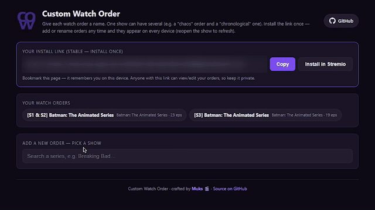
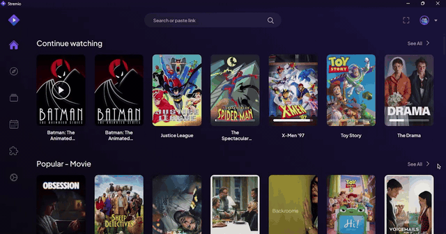

<div align="center">


# Custom Watch Order

**A [Stremio](https://www.stremio.com/) addon that lets you watch a series'
episodes in _any order you define_ — not just 1, 2, 3.**

[](https://stremio-custom-order.pages.dev/configure)

[Configure & install](https://stremio-custom-order.pages.dev/configure) · [How it works](#how-it-works) · [Self-host](#self-host)

</div>

---

## What it does

Ever wanted to watch a show in a **release order**, a **chronological order**, a
**skip-the-filler** order, or your own **chaos rewatch** order? Stremio always
shows episodes in season/episode order and gives you no way to change it.

**Custom Watch Order** fixes that. You build a watch order on a simple
drag-and-drop page, and the show appears in Stremio in exactly that sequence —
while still streaming from whatever stream addons you already have installed.

- 🎬 **Any series** — not a fixed franchise list. Search any show and reorder it.
- 🔀 **Multiple orders per show** — e.g. a "chronological" and a "chaos" cut of the same series, each named.
- 🔗 **Install once** — your install link never changes. Add or rename orders any time.
- ☁️ **Synced across devices** — orders live server-side, so they show up everywhere you use the same link.
- ▶️ **Streams still work** — episodes keep their real IDs, so your existing stream addons resolve them normally.
- 📦 **Export / import** — download one order (or all of them) as `.json` to back up or share, and import a file to add those orders to your own list.

## Demo

**1. Build your order** — search a show, drag episodes into the order you want, name it, and save. It's live on your install link instantly (even recreate an order you found online).

<div align="center">

</div>

**2. Watch it in Stremio** — your order shows up as its own entry, episodes play in your sequence, streaming from the addons you already have.

<div align="center">

</div>

## Install & use

1. Open the **[configure page](https://stremio-custom-order.pages.dev/configure)**.
   It remembers you on this device via a stable personal link (`/u/<your-id>/configure`) — **bookmark it**.
2. **Search a series**, then **drag episodes** from *Default episodes* into the
   *Watch order* column (top = first). Give the order a name.
3. Click **Save order**, then **Install in Stremio** (or copy the install link).
4. The show appears in Stremio's **Custom Watch Order** catalog (a row near the
   bottom of the Home board, or searchable by name). Open it and watch.

To add another order later, just reopen your configure page — the install link
stays the same and new orders appear automatically. (Reopen a show in Stremio to
refresh its cached metadata.)

> ⚠️ **Your `/u/<id>/` link is a private key.** Anyone with it can view and edit
> your orders. Keep it to yourself.

## How it works

Stremio's default metadata provider (**Cinemeta**) owns the real `tt…` IMDb IDs,
and an addon can't override it. So instead this addon **publishes its own copy**
of a series under a `cwo:` ID prefix:

1. The **meta** handler fetches the real Cinemeta metadata for the show.
2. It **rebuilds the episode list** in your chosen order.
3. The trick: each episode keeps its **real** ID (`tt…:season:episode`) so your
   stream addons still resolve it — but season/episode are **renumbered** to
   season 1, episodes 1, 2, 3… Stremio sorts by season+episode (not array
   order), so this is what forces your custom order to actually display.

Orders are stored in **Cloudflare KV**, keyed by your stable personal id, and
served through the `/u/<id>/…` routes.

### URL scheme

| Route | Purpose |
| --- | --- |
| `/u/<id>/manifest.json` | Your personal, live-synced manifest (install this) |
| `/u/<id>/configure` | Your drag-and-drop configure page |
| `/u/<id>/catalog/…`, `/u/<id>/meta/…` | Catalog + reordered metadata |
| `/c/<config>/…` | Stateless snapshot scheme (orders encoded in the URL) — kept for a future "publish/share" feature |
| `/manifest.json` (bare) | Empty + configurable |

## Self-host

The whole addon is a single Cloudflare Pages Worker (`public/_worker.js`) plus a
static configure page — Web-APIs only, no build step.

**Prerequisites:** a Cloudflare account and [`wrangler`](https://developers.cloudflare.com/workers/wrangler/) (`npx wrangler`).

1. **Create a KV namespace** for orders and put its ids in `wrangler.toml`:
   ```bash
   npx wrangler kv namespace create ORDERS_KV
   npx wrangler kv namespace create ORDERS_KV --preview
   ```
   Copy the returned `id` / `preview_id` into the `[[kv_namespaces]]` block
   (binding `ORDERS_KV`).
2. **Deploy:**
   ```bash
   npx wrangler pages deploy public --project-name stremio-custom-order --branch main
   ```
3. Your addon is live at `https://<project>.pages.dev/configure`.

> The KV **namespace ids** in `wrangler.toml` are resource identifiers, not
> secrets — they're useless without your Cloudflare account credentials, which
> live outside this repo.

### Local development

Run the real Workers runtime locally (uses a local KV):

```bash
npx wrangler pages dev public
# → http://127.0.0.1:8788
```

Test in the **desktop** Stremio app — the web player blocks `http://127.0.0.1`.

## Project structure

```
public/
  _worker.js      # the deployed addon (advanced-mode Pages Worker)
  configure.html  # drag-and-drop configure page
  logo.png        # addon logo (manifest + page + favicon all use this)
wrangler.toml     # Cloudflare Pages + KV config
brand/            # master logo copy + how to swap it (not served)
legacy/           # archived v2 stateless Node dev server (see legacy/README.md)
```

To change the logo, replace `public/logo.png` (see [`brand/README.txt`](brand/README.txt)) and redeploy.

## Credits

Crafted by **Muks** 🎬. Metadata from [Cinemeta](https://v3-cinemeta.strem.io/).
Not affiliated with Stremio.
